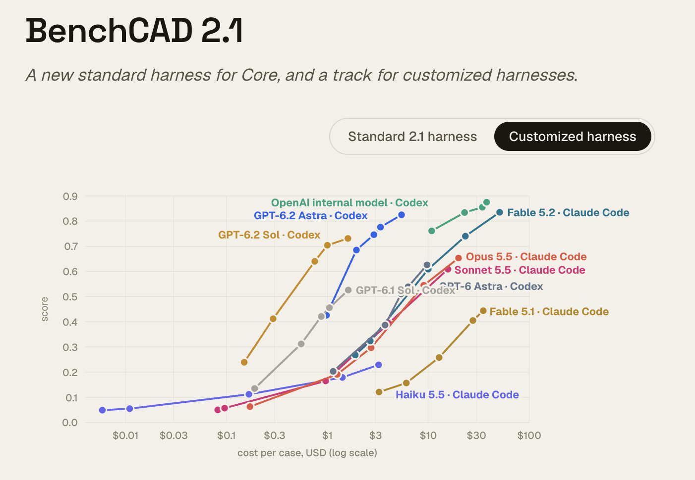

# CadSkill

3D CAD for Claude and Codex. Your agent builds real solid models by writing
[CadQuery](https://cadquery.readthedocs.io) scripts, checks them with
measurements and rendered views, and exports STEP, STL and other files. A
viewer page shows the person the same model as it changes.

There are no modelling controls for the person to operate. You describe the
part; the agent does the modelling.

## Which model to use

How well this works depends mostly on the model writing the scripts.
[BenchCAD 2.1](https://benchcad.com/blog/benchcad-2-1), a benchmark of
programmatic CAD on real engineering work, puts Claude Fable 5.2 and
GPT-6.2 Astra at the top: Fable 5.2 scores 0.754 at max effort in the
standard harness, and Astra 0.825 at max for $5.43 per case. In the track
that runs models in their own agent harness (Claude Code, Codex) with no
token or time limit, both reach about 0.83:



*Customized-harness results from [BenchCAD 2.1](https://benchcad.com/blog/benchcad-2-1).*

## Install

On macOS or Linux, run:

```sh
curl -LsSf https://raw.githubusercontent.com/stepandel/cadskill/main/install.sh | sh
```

That is the whole install. The script installs [uv](https://docs.astral.sh/uv/)
if you do not have it, uses it to put Python 3.12, CadQuery and the
`cadskill` command in a folder of their own (about 1.3 GB, mostly
OpenCASCADE and VTK), and copies the skill to `~/.claude/skills/cadskill`.
You do not need Python, Node or a copy of this repository. (Windows is not
supported yet: the background process is written for macOS and Linux.)

Then start a new Claude Code session and ask for a part, for example "model a
60 × 40 mm mounting plate with four M4 holes". The first build on a computer
takes one to two minutes while the CAD kernel loads (see
[The first start is slow](#the-first-start-is-slow)); after that it is quick.
If the installer says so, open a new terminal first so `cadskill` is on your
`PATH`.

Options go after `sh -s --` and are passed to `cadskill install`:

```sh
curl -LsSf https://raw.githubusercontent.com/stepandel/cadskill/main/install.sh | sh -s -- --desktop
```

| Option | What it does |
|---|---|
| `--agent codex` | Install for Codex instead of Claude Code |
| `--project` | Install the skill for the current project only: `./.claude/skills` for Claude or `./.agents/skills` for Codex |
| `--allow` | Add `Bash(cadskill:*)` to that folder's `settings.json`, so Claude does not ask before each command. Building a model runs its script as Python, so this lets Claude run Python without asking; leave it out to approve commands as they come |
| `--desktop` | Also register the MCP server with the Claude desktop app (below) |

If you already use uv, the installer amounts to:

```sh
uv tool install cadskill
cadskill install            # with any of the options above
```

### For Codex

Install the command and skill on macOS or Linux:

```sh
curl -LsSf https://raw.githubusercontent.com/stepandel/cadskill/main/install.sh | sh -s -- --agent codex
```

If `cadskill` is already installed, run `cadskill install --agent codex`.
This copies the same command-based modelling skill to
`~/.agents/skills/cadskill`. Add `--project` to install into
`./.agents/skills/cadskill` for the current project instead. These are
[Codex's local skill locations](https://developers.openai.com/codex/skills#where-to-save-skills).
Claude remains the default when `--agent` is omitted; you can install for
both agents by running the command once for each.

Start a new Codex session and ask for a part, or invoke the skill explicitly:

```text
$cadskill model a 60 x 40 mm mounting plate with four M4 holes
```

Codex writes scripts, runs `cadskill`, opens the rendered PNGs to check its
work, and shares the pictures in the conversation. For interactive 3D in
Codex desktop, the skill runs `cadskill view MODEL --no-open` and opens the returned
URL in the app's right panel using `open_in_codex` when that tool is
available. This URL stays on the requested model and includes its Revisions
button, even when another model is built. The skill uses the live HTTP URL
for **View in 3D** links, including when revisiting an existing design.
HTML exports are available for requested offline copies or snapshots and
are labeled **HTML snapshot (no history)**. Without an in-app browser,
the skill provides pictures and the live viewer link; it opens the
system browser only when asked. See [the built-in browser](https://learn.chatgpt.com/docs/browser#use-the-desktop-browser).

The first build has the same CAD kernel warm-up as Claude. Codex uses its
existing command permissions; `--allow` and `--desktop` are Claude-only options.

To use the MCP tools instead of the command-based skill, register the
installed server with Codex:

```sh
codex mcp add cadskill -- "$(command -v cadskill-mcp)"
```

For this route, use the MCP skill in `skills/cadskill/` rather than installing
the command-based skill too. Inline 3D depends on the host's MCP Apps
support; `open_viewer` provides the browser viewer when needed.

The repository also contains a portable Codex plugin (`plugin.json` and
`mcp.json`) that bundles this MCP skill and launches the server with `uv`.
Use [OpenAI's local plugin marketplace instructions](https://developers.openai.com/plugins/build/plugins#install-a-local-plugin-manually)
to install it from a copy of this repository. `npm run package` includes
both the portable and Claude manifests in `dist/cadskill-plugin.zip`.

### For Claude desktop chat

Chat sessions cannot read skills from `~/.claude` or run commands, but they
can use the desktop app's local MCP servers. Install with `--desktop` (or run
`cadskill install --desktop` after installing):

```sh
curl -LsSf https://raw.githubusercontent.com/stepandel/cadskill/main/install.sh | sh -s -- --desktop
```

This adds a `cadskill` entry to `claude_desktop_config.json` (keeping a copy
of the file as it was, next to it, ending in `.before-cadskill`). Quit and
reopen the Claude desktop app; the CadSkill tools then appear in chat.

### As a Claude plugin

The repository is also a Claude plugin that runs the MCP server. Use this
where the host shows the viewer inline (MCP Apps), or in Cowork. Use either
the plugin or the `cadskill` skill, not both: the two skills share a name and
teach different ways to call the tools.

- **Claude Code**: `claude --plugin-dir .` from a copy of this repository.
- **Cowork**: `npm run package`, then upload `dist/cadskill-plugin.zip` at
  Customize > Plugins > Add > Upload plugin. Cowork runs a plugin's local
  server only when the session runs on your computer.

The plugin needs [uv](https://docs.astral.sh/uv/) but no separate install:
`uv` sets up the server the first time the plugin starts it.

### Check that it works

```sh
cadskill --version
cadskill status      # "Not running" is fine: the first command starts it
cadskill models      # lists saved models (none on a new install)
```

### What goes where

| What | Where | Why |
|---|---|---|
| The skill | `~/.claude/skills/cadskill/SKILL.md` | Tells Claude how to model with `cadskill` and check its work |
| The Codex skill (with `--agent codex`) | `~/.agents/skills/cadskill/SKILL.md` | The same modelling workflow for Codex |
| The commands | `cadskill`, `cadskill-mcp`, in uv's tool folder (`~/.local/bin`) | Run the scripts and serve the tools; nothing of them lives in Claude's folder |
| Your models | `~/Documents/CadSkill/` (or `$CADSKILL_HOME`) | Every version of every model, as plain files |

Nothing else goes into Claude's folder: no hook, and no MCP entry unless you
ask for `--desktop`. Showing a model as an artifact needs nothing installed
either; Claude publishes the page `cadskill export MODEL html` writes.

### Update

Run the install line again, with the options you used the first time. It
stops the background process, so the next command runs the new version. If
you registered the desktop app, quit and reopen it as well.

If you installed CadSkill earlier from a copy of this repository (`uv tool
install ./server`), the installer removes that install for you.

### Moving over from CadDraft

This project used to be called CadDraft. If you installed it under that name,
remove the old command, skill and desktop entry first, then install as above:

```sh
caddraft stop               # the old background process, if one is running
caddraft uninstall
uv tool uninstall caddraft-mcp
```

(`caddraft uninstall` says your models are in `~/Documents/CadDraft`; they
are, until CadSkill moves them.)

Your models move by themselves: the first time CadSkill runs, it renames
`~/Documents/CadDraft` to `~/Documents/CadSkill` if the new folder does not
exist yet.

### Uninstall

```sh
cadskill uninstall          # removes the skill, and the desktop app's entry if there is one
cadskill uninstall --agent codex  # removes the Codex skill, if installed
uv tool uninstall cadskill
```

Your models stay in `~/Documents/CadSkill/`; delete that folder too if you
want them gone.

## How an agent works with a model

The model is a CadQuery script in a file. The agent writes `bracket.py`, runs
`cadskill run bracket.py`, reads the sizes it prints and opens the four-view
picture it writes to `.cadskill/bracket.png`, edits the file and runs it
again. Each successful run is saved as a version. A script that fails changes
nothing: the reply names the failing line and the previous version stays
current.

| Command | Purpose |
|---|---|
| `cadskill run SCRIPT` | Build and save a new version; write the four-view picture |
| `cadskill render MODEL` | A named view or custom direction; `--section` cut; `--highlight` what a selector matches |
| `cadskill inspect MODEL` | List a part's faces, edges or vertices with position, type, normal and size |
| `cadskill measure MODEL A B` | Shortest distance (and angle, where it applies) between two selections |
| `cadskill export MODEL FORMAT` | STEP, STL, 3MF, GLB, BREP, SVG, or HTML |
| `cadskill import MODEL FILE` | Make a STEP or BREP file available to the script |
| `cadskill show`, `versions`, `restore`, `models` | The saved script, history, undo, all models |
| `cadskill view MODEL --no-open` | Get a live model URL with Revisions for an in-app preview |
| `cadskill replay MODEL [--version N] --no-open` | Inspect a revision with upstream Jupyter CadQuery Replay (optional install) |
| `cadskill status`, `stop` | The background process |

**Seeing the model.** `cadskill view MODEL --no-open` prints the local viewer
URL without launching a browser. The URL includes the model name and follows
its latest version, with Revisions available; leave `MODEL` out to follow
whichever model was built most recently. The skill opens the URL inside the
host app when supported and links to that URL in the conversation. Bare
`cadskill view MODEL` still opens the system browser when requested.
`cadskill export MODEL html` produces an offline snapshot with no History;
it is for explicit HTML or offline export requests. The skill also shares
rendered PNGs in the chat.

**Keeping history together.** Use the same model name for revisions, and
`--note` to label each change. If script files have revision suffixes, use
`cadskill run bracket_v2.py --model bracket --note "Longer mounting slots"`
to append to the existing model's history rather than creating a new model.

**Build-step inspection.** Install the optional upstream recording library with
`uv tool install --force 'cadskill[replay]'` (development: `uv sync --project server --extra replay`).
Restart CadSkill after changing its installed dependencies. The live viewer's
**Build steps** button opens a floating panel like Revisions. Assemblies open
with an **Assembly** overview listing each part and its recorded step count.
Selecting a part's operation draws its geometry in the existing model canvas,
with the other parts faded for context. **Assembly** restores the complete
saved design (**Final model** for a single part). This is an overview of the
assembled geometry, not a recorded timeline of assembly placement or constraints.
Sketch points, curves and solid stages
use that same canvas, controls and readout. Agents can use
`cadskill replay MODEL --version N --no-open` or the MCP `open_build_steps`
tool and open the returned CadSkill URL inside the host app. A version in
this link selects that saved revision, with Build steps already open.
Bare `cadskill replay`
opens the system browser, like `cadskill view`.

This reuses [Jupyter CadQuery Replay](https://bernhard-42.github.io/ocp_viewer_docs/viewers/jupyter_cadquery/replay/)
for recording and formatting Workplane/Sketch chains. A small adapter uses
its recorded CAD objects with CadSkill's existing meshing and viewer code.
The tested upstream API is bounded to version 5.3. Recording runs in a
dedicated worker, without launching notebook kernels, a second viewer, or
a viewer service. Direct solid operations and imported STEP parts do not
supply their original feature history. Partial histories are labeled, and
scripts retaining no replayable chain keep their final geometry available.
Normal installs do not need the optional recording library.

For new models, retain Workplane/Sketch chains through part builders,
cutters and the finished objects added to an assembly. Use the fluent
`union`, `cut` and `intersect` operations. Extracting `.val()` and continuing
with raw Shape booleans disconnects those operations from Replay. Wrapping
the resulting solid in a new Workplane cannot restore its previous chain.
When refactoring an existing model for history, compare a copy against the
original using valid solids, extents, volume and bidirectional geometry
differences, then save the refactor as a new revision of the same design.

**Rebuilding a revision.** New saves include copies of imported assets and
an `environment.json` recording Python, CadQuery and the CAD kernel package.
Version browsing and restoration use those saved inputs. Rebuilding under
a different recorded CAD runtime reports the required versions instead of
silently changing geometry; install those versions before retrying. Older
revisions without snapshots use the imported files still available. Importing
different contents with an existing filename returns a new filename and
preserves the original input.

For a selective change, such as removing mounting holes while retaining
longer pins, edit the current Python recipe and rebuild. Use normal parameters
for repeated feature toggles. Whole-design restoration rebuilds the old recipe
as a new revision, preserving the later saves. Replay is an inspector, not
an arbitrary feature-suppression engine.

**The background process.** Loading the CAD kernel is too slow to do on every
command, so the first command starts a process that keeps it loaded and
serves the viewer page; it stops after an hour without commands. It listens
on this computer only, and a command must present a token kept in a file only
you can read, so a web page open in your browser cannot use it to run a
script.

## The plugin and MCP server

The same tools are also an MCP server, packaged for Claude and Codex. Use this
where a host shows the viewer inline (MCP Apps), or for a client that speaks
MCP but has no shell. Use one or the other, not both: the two skills have the
same name and teach different ways to call the tools.

| Piece | What it is |
|---|---|
| MCP server (`cadskill-mcp`, or `cadskill mcp`) | The tools below, over stdio |
| Skill (`skills/cadskill/`) | The same guidance, written for the MCP tools |
| Viewer | Offered to the host as an MCP App |

Claude sends a full script with `run_model` or changes the current one with
`edit_model`. Each reply carries every part's size, volume and extents,
anything the script printed, and one picture with four views.

| Tool | Purpose |
|---|---|
| `run_model` | Build from a complete script and save a new version |
| `edit_model` | Exact text replacement in the current script, then rebuild |
| `get_model` | The current script, version number and parts |
| `render` | A named view or custom direction; optional section cut; highlight what a selector matches |
| `inspect` | List a part's faces, edges or vertices with position, type, normal and size |
| `measure` | Shortest distance (and angle, where it applies) between two selections |
| `export` | STEP, STL, 3MF, GLB, BREP, SVG or HTML |
| `import_file` | Make a STEP or BREP file available to the script |
| `list_versions`, `restore_version` | History and undo |
| `open_build_steps` | Upstream Replay for a saved revision (optional `cadskill[replay]`) |
| `list_models` | Models saved on this computer |
| `open_viewer` | Address of the live viewer page |
| `get_mesh`, `get_history` | Used by the viewer only; hidden from Claude by hosts that support MCP Apps |

Models are plain files, one folder each, under `~/Documents/CadSkill/`
(set `CADSKILL_HOME` to move them): `current.py`, every version under
`versions/`, imported files under `assets/`, exported files under `exports/`.

To install the plugin, see [As a Claude plugin](#as-a-claude-plugin).

## The first start is slow

**The first start on a computer takes one to two minutes.** Measured on an
Apple-silicon Mac: 85 to 97 seconds, almost all of it macOS checking the
large native CAD libraries (OpenCASCADE and VTK) the first time each is
loaded. It is not the download and not Python compiling. The `cadskill`
command waits for it (up to 100 seconds per command, then says to run the
command again). What the plugin's server does about it:

- The server itself starts at once and begins loading CadQuery in the
  background, so the tools are listed immediately.
- A tool called before the kernel is ready answers within 25 seconds that it
  is still starting, and the skill tells Claude to say so and try again,
  instead of the call hanging.
- The plugin installs with `UV_LINK_MODE=hardlink`, so the checked library
  files are shared with `uv`'s cache. A later reinstall (a plugin update) then
  starts in about 12 seconds instead of paying the full cost again. This needs
  the plugin and `uv`'s cache on the same disk; otherwise `uv` copies and each
  reinstall is slow once.

After the first time, starting takes about 3 to 5 seconds.

## What has and has not been tried

Tested here: every `cadskill` command against the real kernel, the skill
install, the live viewer page, the single-file HTML export opened with no
server, the server over stdio and every tool. `claude plugin validate .`
passes. The live viewer also renders a saved two-part model in Codex's
right-hand browser panel.

Not yet tried:

- **A Claude session driving the installed skill** from a first request to a
  finished part.
- **A Codex session driving the skill or plugin** from a first request to a
  finished part, including any inline MCP Apps viewer.
- **The HTML export as a published artifact.** It publishes; whether the
  viewer draws inside the artifact frame has not been looked at.
- **Windows.** The background process is written for macOS and Linux.

The plugin, not yet tried in a real host:

- **The inline viewer.** The server offers the viewer as an MCP App
  (`ui://cadskill/viewer.html`). Whether the Claude desktop app renders it
  inline from a plugin's local server is untested. If it does not, Claude
  still gets the pictures, and `open_viewer` gives a local address.
- **Cowork.** Whether `uv` can install the dependencies where Cowork runs
  the server is untested.
- **Plain chat.** Chat ignores a plugin's local server. The documented route
  there is a desktop extension (`.mcpb`); that packaging is not built yet.
- **Claude Code** shows MCP Apps as text, so there the viewer is the local
  page.

## Trust

A CadQuery script is ordinary Python. It runs on your computer with your
permissions, the same as any code Claude runs for you. The server runs
scripts in a separate process and stops them after a time limit, which
contains hangs and crashes; it is not a security sandbox.

## Develop

```sh
npm install                 # viewer build tools
npm run build               # bundles the viewer into server/cadskill_mcp/static/viewer.html
npm test                    # server tests against the real kernel (uv run --project server pytest)
npm run package             # build + dist/cadskill-plugin.zip
uv run --project server cadskill-mcp --page   # serve only the viewer page, at http://127.0.0.1:8791/
uv run --project server cadskill run part.py  # the command, straight from the source
```

After changing the server while a background process is running, `cadskill
stop` so the next command starts one with the new code.

To try the installer against your working copy instead of PyPI:

```sh
(cd server && uv build)
CADSKILL_PACKAGE=server/dist/cadskill-0.1.3-py3-none-any.whl sh install.sh
```

### Release

Bump `version` in `server/pyproject.toml`, `plugin.json`,
`.claude-plugin/plugin.json`, `package.json` and the viewer's App metadata
in `src/ui/host.js`. Refresh the lockfiles and rebuild the viewer, commit,
then push a matching tag:

```sh
git tag v0.1.3 && git push origin v0.1.3
```

`.github/workflows/release.yml` builds the package and publishes it to PyPI
through trusted publishing. It needs, once, a trusted publisher on PyPI for
the `cadskill` project: this repository, workflow `release.yml`, environment
`pypi`.

The built `viewer.html` is committed so an installed plugin needs no Node.
Rebuild and commit it whenever `src/` changes.

## Layout

| Path | What it is |
|---|---|
| `install.sh` | The one-line installer: uv if missing, then `uv tool install cadskill` and `cadskill install` |
| `.github/workflows/release.yml` | Publishes the package to PyPI when a `v*` tag is pushed |
| `.claude-plugin/plugin.json` | Plugin manifest; starts the server with `uv run` |
| `plugin.json`, `mcp.json` | Portable Codex plugin manifest and stdio MCP server configuration |
| `skills/cadskill/SKILL.md` | The plugin's skill (MCP tools) |
| `server/pyproject.toml`, `server/README.md` | The `cadskill` package and its PyPI page |
| `server/cadskill_mcp/skill/SKILL.md` | The skill `cadskill install` copies (`cadskill` commands) |
| `server/cadskill_mcp/cli.py` | The `cadskill` command and the skill installer |
| `server/cadskill_mcp/daemon.py` | The background process the command talks to |
| `server/cadskill_mcp/server.py` | The tools, the viewer resource and the local viewer page |
| `server/cadskill_mcp/worker.py` | Everything that touches CadQuery: running scripts, describing parts, meshing, rendering, exporting |
| `server/cadskill_mcp/runner.py` | Starts the worker process and replaces it on a timeout or crash |
| `server/cadskill_mcp/store.py` | Models and versions on disk |
| `server/tests/` | Tests through the worker process and through an MCP client |
| `src/index.html` | The viewer's markup and styles |
| `src/ui/app.js` | Viewer entry point |
| `src/ui/host.js` | Gets models from the host (MCP App), by polling the local server, or from the page itself (HTML export) |
| `src/ui/viewer.js` | Three.js view: parts, selection, picking, camera, theme |
| `src/ui/readout.js` | The top-right readout and the dock's part label |
| `scripts/build.mjs` | Bundles the viewer into one HTML file |
| `scripts/package.mjs` | Zips the plugin for upload |

## How it fits together

`server.py` holds the tools. MCP reaches them directly; the `cadskill`
command reaches the same functions through `daemon.py`, so the two cannot
drift apart. Every operation that needs geometry goes to
one long-lived worker process, which imports CadQuery once and caches the
shapes of the last few scripts by hash. Because each request names its
script, the worker holds no state the server depends on: it can be killed on
a timeout and the next request simply rebuilds.

Pictures are drawn off-screen with VTK (already a CadQuery dependency), with
no perspective so lengths can be compared by eye.

The viewer never sees a script. A build tool's result carries only the model
name and version; the viewer then asks for that version's meshes through
`get_mesh` (inline) or `/mesh` (local page), so triangle data stays out of
Claude's context. The Revisions button in the viewer lists every saved version
(`get_history` or `/history`); picking one shows it without changing the
model, which stays at its latest version until the assistant restores another.
Optional Replay runs in a separate CAD worker so its recording hooks
never affect the normal CAD worker. Shapes are cached by source and input
context, keeping imported geometry from different revisions separate.
`get_build_steps` / `/build-steps` provide the recorded operation list;
`get_step_mesh` / `/step-mesh` provide the selected operation's geometry.

## History

Earlier versions ran the OpenCASCADE kernel in the browser as WebAssembly,
with a step list edited in the page. The last commit of that design is
tagged `browser-kernel`.

## Dependencies

- `cadquery` (Apache-2.0) on the OpenCASCADE kernel (LGPL-2.1 with an
  exception), and `vtk` (BSD) for pictures
- `mcp`: the Model Context Protocol Python SDK (MIT)
- `three` 0.187.0 (MIT) and `@modelcontextprotocol/ext-apps` 2.0.4 in the
  viewer
- `esbuild` to build the viewer

Review the licences before distributing a build.
